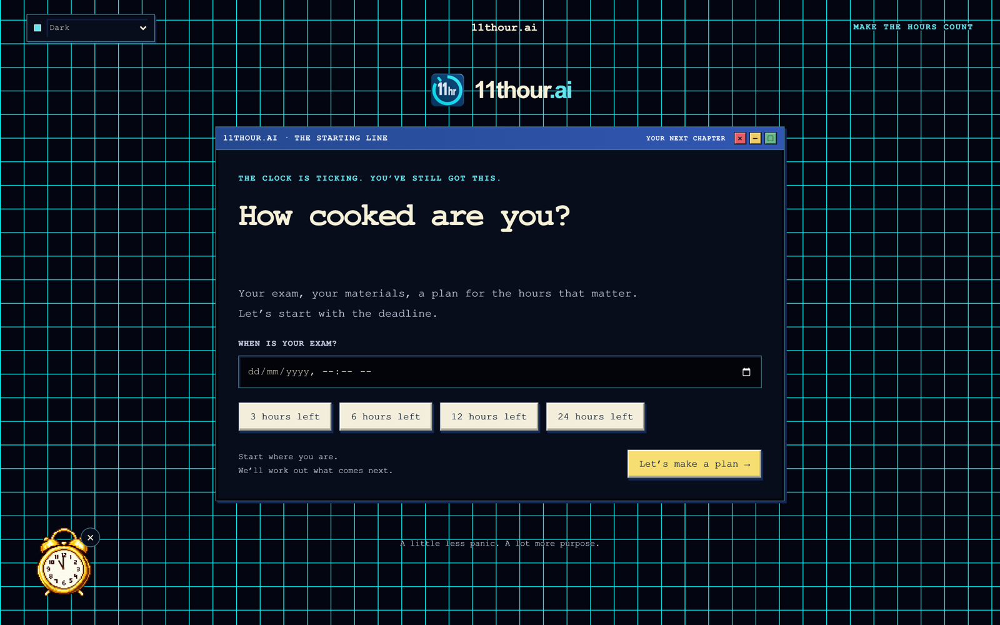
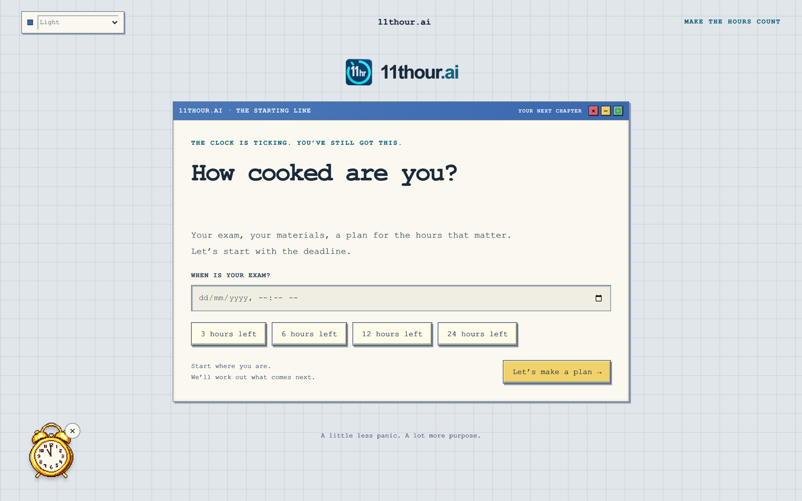
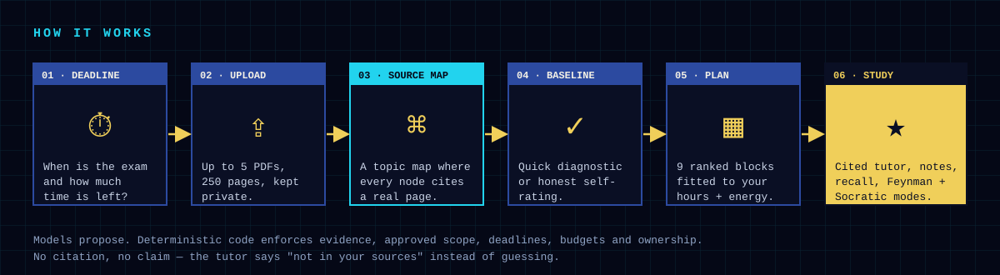
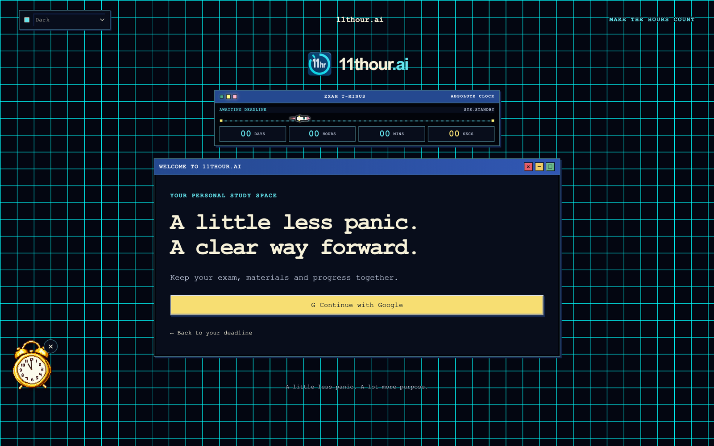

<p align="center">
  
</p>

<p align="center">
  
  
  
  
</p>

<h3 align="center">The AI study planner for the last hours before an exam.</h3>

<p align="center">
Upload your own lecture PDFs. 11thour turns them into a source-backed topic map,<br>
checks what you already know, and builds a ranked plan for the time you actually have left.<br>
Then it teaches you with a tutor that cites your material, or says so when it can't.
</p>

---

<p align="center">
  
  
</p>

## How it works

<p align="center"></p>

## What's inside

<table>
  <tr>
    <td width="33%" valign="top">
      <br>
      <b>PDF → topic map</b><br>
      <sub>Up to 5 PDFs and 250 pages per batch. Every topic and subtopic points to the exact page it came from. Image-only pages are flagged, never faked.</sub>
    </td>
    <td width="33%" valign="top">
      <br>
      <b>Nine-block exam plan</b><br>
      <sub>Blocks ranked from must-master to optional, fitted to your deadline, available hours, energy and learning preferences. Drill down from whole plan to block to single activity.</sub>
    </td>
    <td width="33%" valign="top">
      <br>
      <b>Cited tutor</b><br>
      <sub>Answers are grounded in your own uploads with page citations. Feynman and Socratic modes make you explain things back, with feedback saved per answer.</sub>
    </td>
  </tr>
  <tr>
    <td valign="top">
      <br>
      <b>Interactive notes and recall</b><br>
      <sub>Notes generated from selected source passages, flashcards, and practice questions. Maths and chemistry render as real notation.</sub>
    </td>
    <td valign="top">
      <br>
      <b>Manual override</b><br>
      <sub>Reorder blocks or add a topic. A retro warning window explains the trade-off first; your original accepted plan is kept as its own version.</sub>
    </td>
    <td valign="top">
      <br>
      <b>Mr. Clock and the retro studio</b><br>
      <sub>A pixel-art companion, light and dark themes, 3D menu tokens and a live exam countdown. Studying at 2 a.m. should at least look good.</sub>
    </td>
  </tr>
</table>

## Built to be honest

| Principle | What it means in the product |
| --- | --- |
| **No citation, no claim** | The tutor answers from your sources or tells you the material doesn't cover it. General explanations are labelled as general. |
| **Models propose, code decides** | LLMs draft maps, plans and activities. Deterministic code checks evidence, approved scope, time limits and ownership before anything is saved. |
| **Your files stay yours** | Private storage, per-account ownership checks and row-level security in the database. Nothing is shared between accounts. |
| **No false success** | Failed, partial or unreadable uploads say so. A spinner never pretends work finished. |
| **Spending has a ceiling** | Every model call is reserved against a hard budget and time window before it runs. |

## Under the hood

```text
app/          Next.js App Router pages and API routes
components/   Retro studio UI: windows, tokens, planner, tutor, notes
lib/          PDF pipeline, retrieval, planner, tutor, security, budgets
supabase/     Postgres schema and migrations with row-level security
```

<p>
  
  
  
  
  
  
  
  
  
  
</p>

- **~750 commits**, **480+ test files**, **46 database migrations** since June 2026
- Google sign-in through Supabase Auth, owned-data checks on every request
- PDF text extraction, chunking and embeddings for source retrieval

## Status

11thour is in a **private, invite-only pilot**. The application source is kept private while it's in testing; this repository is the public home for the project. You can join the waitlist at **[11thour.ai](https://11thour.ai)**.

<p align="center">
  
</p>

<p align="center"><sub>Made by <a href="https://github.com/aryanchavandev">Aryan Chavan</a> · A little less panic. A lot more purpose.</sub></p>
